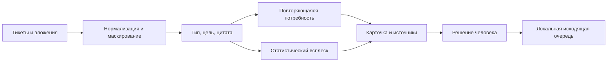

# Устройство Радара

Радар объединяет два способа найти значимую тему в обращениях. Потребности накапливаются за окно наблюдения, даже если число сообщений не выросло резко. Детектор инцидентов сравнивает поток темы с фоном и помогает проверить результат исправления.

## Код и ответственность

| Файл | Назначение |
|---|---|
| `radar_app/core.py` | Приём обращений, дубли, каталог тем, цитаты и решения |
| `radar_app/privacy/` | Маскирование регулярными выражениями и NER |
| `radar_app/gateway.py` | Контракт внутренней модели, ограничения адресов и размеров |
| `radar_app/prompts.py` | Системный промпт и схема результата |
| `radar_app/tools.py` | Пять ограниченных инструментов потребностей |
| `mvp-v13-adapted/radar/detect.py` | Фон, Пуассон/EWMA и статистический сигнал |
| `mvp-v13-adapted/radar/verify.py` | Проверка возврата темы к обычному уровню после фикса |
| `mvp-v13-adapted/app/tools.py` | Семь инструментов инцидентного агента |
| `mvp-v13-adapted/app/history.py` | Чтение сохранённой истории с пагинацией |
| `mvp-v13-adapted/app/autoreply.py` | Проверки допуска и шаблонные ответы демо |
| `radar_app/economics.py` | Часы, денежная доля, освоение и дисконтированный предел |

Один повторно доставленный ID не создаёт новое обращение. Один автор нескольких обращений не становится несколькими независимыми голосами. В учебном режиме темы готовятся при трёх авторах в окне 28 дней; настройка не заменяет проверку полезности владельцем продукта.

В карточке можно перейти к проверке источников. История загружается страницами, фильтруется по продукту, теме, времени и каналу. Обезличенный код автора позволяет связать его сообщения. У старых записей демо полнота истории ограничена сохранёнными источниками; новый проигрыватель фиксирует фактическую принадлежность обращений.

## Решения и инструменты

Потребности: `list_topics`, `get_evidence`, `search_tracker`, `queue_draft`, `queue_digest`. Их вызывает приложение по действию человека. Модель возвращает анализ по JSON-схеме. Для черновика требуется решение `accepted`; сервер проверяет продукт и аргументы. Повторный вызов не создаёт вторую запись очереди.

Инциденты: `get_cluster`, `get_releases`, `get_incidents`, `search_tracker`, `search_kb`, `create_ticket_draft`, `notify_team`. Код исполняет разрешённые вызовы и проверяет ссылки в утверждениях модели. Текст обращения не получает права исполнять команды.

Человек подтверждает инцидент, включает шаблонный автоответ, проверяет фикс и подтверждает дальнейшие действия. Очередь `pending_delivery` показывает подготовленный результат. Реальная доставка подключается отдельным адаптером.

Целевая архитектура разделяет импорт, обработку вложений, анализ и доставку по правам и характеру нагрузки. Локальный прототип работает одним процессом с SQLite. PostgreSQL, SSO, подключения к источникам и доставщик требуют отдельной интеграции и приёмки.
